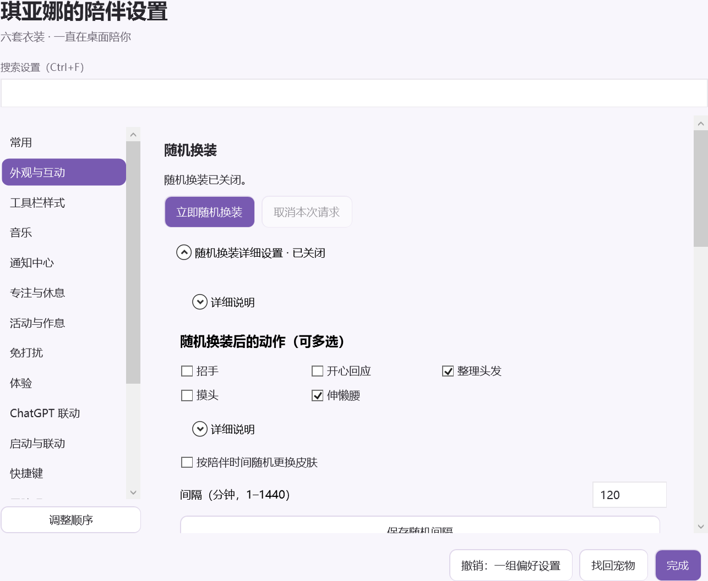
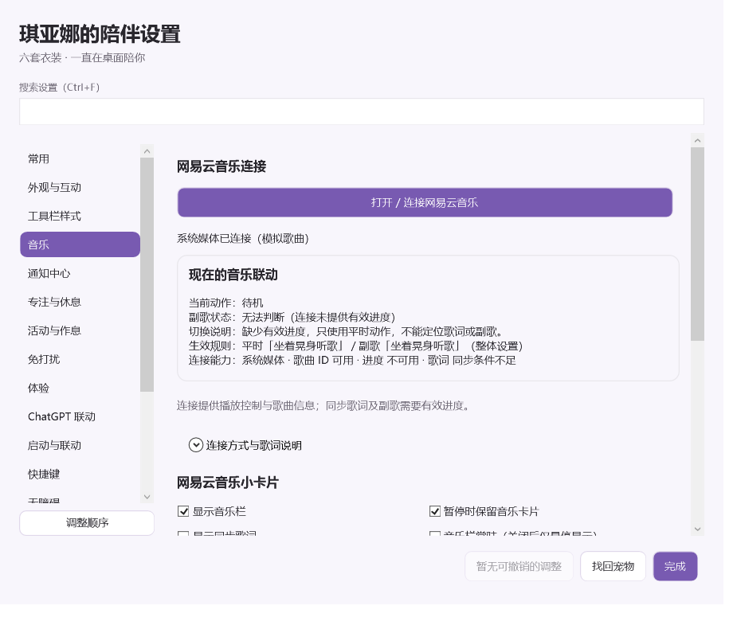

# 音乐状态、共享偏好与日常陪伴（0.9.7）

保留原有页面、Hooks 与系统媒体联动。没有新增或启用内存读取，也不更改 GPT、网易云的启动方式。自动场景、外部任务接收及电池策略默认关闭，性能默认保留原有策略，专注计时需手动开始。

## 随机换装

入口：**设置 → 外观与互动** 顶部，立即随机按钮和状态始终位于详细设置外，不会随折叠区隐藏。展开 **随机换装详细设置 → 随机换装后的动作（可多选）** 可调整动作，也可搜索“随机换装”。

顶部的 **立即随机换装** 用于单次测试：跳过剩余倒计时，可以保持设置窗口打开，仍等待安全的动作循环衔接点。GPT 正在处理、等待处理、失败或状态待确认的任务，以及拖动、互动、专注、副歌、菜单等保护仍生效；定时自动换装仍等待设置窗口关闭。页面分别显示运行任务、外部菜单、桌宠菜单、通知速览、通知中心、存储管理、显示器恢复、鼠标操作等具体原因。自动模式关闭或“今天固定”期间也能主动请求一次，但不会修改自动开关或固定日期；成功后会按原规则重新计时。

GPT 已结束但待查看（review）不再算作正在处理。若没有其他运行或待处理任务，可在待查看动作自己的循环衔接点换装，保留动作时间轴和未读通知，不强行改为待机、不自动标记已读。若另有活动任务，仍按该任务的真实状态等待；连接数据过期时不据此授权待查看姿态换装，等原联动恢复或回到待机。

待查看动作的衔接遵循已设倍速。需要时会暂时细化桌宠自己的绘制调度，避免安静模式与高倍速组合一直错过衔接首帧；完成、取消或被其他条件阻挡后恢复原性能策略，GPT 与音乐轮询不变。

重复点击只保留一个请求，可用 **取消本次请求** 撤回。取消只影响本次手动请求，原定时规则照常工作。手动选衣装、修改随机设置、点击今天固定或恢复计时，也会取消旧请求。没有其他候选时按钮不可用；素材失败会保留原皮肤、显示原因并结束请求，不反复尝试。单次请求仅本次运行有效，不跨重启恢复，也不参与偏好同步。

| 选项 | 默认与行为 |
| --- | --- |
| 按陪伴时间随机更换 | 开启；每 120 分钟，支持 1–1440 分钟 |
| 少量时间浮动 | 开启；间隔在设定值的 90%–110% 内，例如默认约 108–132 分钟 |
| 每次启动时随机一套 | 关闭；可单独使用，在首次显示前选择，开启后不需要同时启用定时更换 |
| 换装后的动作 | 默认勾选五个现有动作：招手、开心回应、整理头发、摸头、伸懒腰；多选时随机播放一个，尽量不连续重复，全部取消则仅气泡 |
| 参与皮肤 | 默认仅冬祈新愿、炽愿吉星、时砾逐光三套 Q 版；可从六套中自行勾选 |
| 今天固定这套 | 本机保留至当天结束；恢复按钮可立即取消固定并重新计时 |

候选皮肤打乱后逐轮使用；当前皮肤计入起始轮，避免紧接着换到同一套。只有一套候选且已在使用时不重复换装，没有候选时保持当前衣装。手动选衣装、应用预览中的衣装或调整随机设置后重新计时，手动换装保留原有挥手，气泡改用随机文案。

定时仅累计桌宠窗口显示且清醒的陪伴时间。隐藏、锁屏或休眠不补计，退出程序也不计时；到时间后只保留一次待更换请求，不会在回来后连续补换。倒计时、剩余候选和当天固定存于本机 `skin-shuffle-session.json`，运行中约每 30 秒及退出时保存，重开后继续剩余时间；跨日解除固定时恢复完整间隔。强制结束进程时最多可能回退到上次检查点。

更换会等待待机、已结束待查看动作的循环结束，或 Q 版坐着听歌的平稳循环衔接点。拖动、互动、挥棒、坐下／起身过渡、已知副歌、GPT 活动任务、专注计时、睡眠、免打扰或菜单操作期间暂缓；设置窗口仅阻止未主动请求的定时换装。不能识别副歌时只依据实际动作判断，不假装知道副歌位置。包含普通版候选时，音乐动作期间等待日常待机，避免随机切到不支持音乐动作的版本；自选普通版仍遵循原有素材能力。

自动换装不发送新的音乐播放指令，不改变窗口位置、大小、音乐会话时间轴及轮询；展示动作使用独立绘制时钟。素材缺失或读取失败时回到原皮肤并显示原因。工具栏选择“当前服装”作为颜色来源时随换装更新。

换装增加约 **0.3 秒** 的人物过渡：旧形象用 120 毫秒淡出，新形象随后用 180 毫秒淡入，不叠加两个角色；音乐栏和工具栏保持原有显示。手动选择、立即随机与定时更换都支持，随机更换仍先等待安全衔接点。启动随机在首次显示前选定，没有旧形象时直接显示。

过渡沿用 **设置 → 体验 → 防误操作与动画 → 动作与换装使用平滑过渡**；关闭此项、开启“减少动态效果”或关闭系统动画时，直接切换。拖动、隐藏、调整尺寸或新动作接管时结束视觉过渡，立即恢复当前人物；自动换装期间 GPT 新任务切入也会结束过渡，不回退已选衣装、不重置任务和播放进度。快速连续选择会从当前画面继续，旧回调不会覆盖最新选择，结束后释放过渡图片。


随机换装淡入完成后，按多选结果随机播放 **一个现有图集动作**。招手、开心回应、整理头发、摸头、伸懒腰沿用动作预览中的原始人物帧、过渡与比例校准；普通版沿用预览中的招手／开心回退。按触发时的动作倍速播放一轮，全部不选时只显示气泡。手动选衣装仍保留原有招手与随机文案。

原本坐着听歌时，用已有 **起身过渡 → 所选动作 → 坐下过渡** 衔接，随后回到当下的听歌相位。展示使用独立的短时绘制时钟，不把任务状态改成互动、不暂停或重建音乐会话、不改播放进度、窗口位置与连接轮询；副歌和新任务仍由原规则判断，可立即接管画面。音乐状态页会解释当前正在播放换装动作，并显示起身、实际动作或坐下阶段。

关闭平滑过渡只跳过淡出／淡入，不关闭已勾选的人物动作。开启减少动态效果或关闭系统动画时，保留静态气泡、不播放展示动作。关闭气泡仍可播放所选动作。

随机换装气泡约 **2.8 秒**，手动换装保留原有 3 秒；立即随机、定时与手动选择共享八句文案，例如“今天这套，喜欢吗？”“新造型，准备就绪！”“换个心情，继续陪你～”。本次运行中打乱后逐轮使用，一轮内不重复，跨轮不连续重复；被屏蔽的随机提示不消耗文案，不写入共享偏好或重启检查点。


关闭气泡只关闭文案，仍可播放展示动作；免打扰、隐藏、锁屏、休息、专注计时、任务处理或操作人物时不播放随机展示。已有气泡保留文字与显示时长，互动或 GPT 活动任务优先。新动作、任务、拖动、隐藏或尺寸变化切入时立即结束展示，恢复原渲染规则，不延迟补发提示。新的随机请求会等当前过渡或展示结束；手动选衣装可接管，旧回调不会清理新动作；失败、未实际更换及启动时首次选装不显示成功提示。手动选衣装保留挥手并使用同一文案池，不叠加第二个展示动作或随机换装提示。


开关、间隔、时间浮动、候选列表与动作多选可随通用偏好／共享快照迁移；本机倒计时、候选轮次和当天固定不参与同步。桌宠右键的“换一套衣服”菜单也提供当天固定和恢复入口。



## 看懂当前音乐动作

在 **设置 → 音乐** 顶部，连接按钮下方可以看到实时说明；音乐卡片右键或桌宠右键的“音乐与工具栏”中，选择 **查看音乐联动状态** 可直接到达。

- **当前动作**：实际正在显示的动作，不把计划中的副歌动作当成已经播放。
- **副歌状态**：平时播放、副歌中、下一段起点及剩余时间，或者明确显示无法判断。手动区间优先，关闭自动查询后仍可用。
- **切换说明**：解释首次等待、短暂停顿保留、没有可靠进度、没有区间、自动查询关闭、动作关闭、两阶段动作相同、普通版素材不支持，以及被睡眠、拖动、免打扰、GPT 任务或菜单接管的原因。
- **生效规则**：显示本曲最终使用的平时／副歌动作，以及是否存在单曲覆盖。
- **连接能力**：显示当前来源、歌曲 ID、进度和歌词同步条件。不会按连接时刻推测播放位置。

有可靠进度才显示下一段副歌倒计时。缺少进度、样本过期或缺少区间时，不假装已识别到副歌；本功能只解释原有选择逻辑，不改动动作优先级。



## 两台电脑共享通用偏好

入口：**设置 → 场景与维护 → 共享偏好快照**。

1. 两台电脑绑定同一份 JSON 文件。可以使用已有的同步盘或共享目录；桌宠本身不提供云盘账号或传输服务。
2. 首台电脑点击 **发布本机通用偏好**。
3. 另一台点击 **检查差异并选择应用**，逐项勾选需要的修改，再点击 **备份并应用**。不需要的字段保留本机值。
4. 要反向发布时，先检查文件，再发布。若预览后文件又被其他设备修改，会拒绝覆盖，重新检查即可。

共享衣装、主题、动作、歌词显示、专注时长等通用偏好。本机安装路径、共享文件路径、连接方式、快捷键、屏幕坐标、显示器布局、性能策略、自动场景规则及外部任务接收开关保持独立。计时器本轮进度和任务事件不共享。

发布使用修订编号、文件内容校验、写入锁和原子替换。它可防止同一可见文件的并发覆盖；同步盘离线时两台电脑各自产生的冲突副本仍需手动选择，不宣称自动解决跨设备离线冲突。快照不会自动拉取应用，也不会自动提交到 GitHub。程序源码仍沿用原有 Git 更新流程。

## 自动切换场景

入口：**设置 → 场景与维护 → 自动场景切换**。

先保存工作、休闲等场景，再添加规则。支持正在播放音乐、指定前台进程、电池供电、指定时段；时间段支持跨午夜。规则从上往下匹配，持续匹配至少两秒后切换，列表可上移、下移和删除。音乐触发的场景必须保留音乐开启，避免场景自己关闭触发来源。

场景是临时覆盖：规则退出时恢复进入自动场景前的值，保存设置时不会把临时覆盖写成永久偏好；期间手动改动的不同值会保留。手动应用场景或导入偏好后，自动模式暂停，点击 **恢复自动切换** 后才继续。关闭自动模式也会恢复原值。前台匹配只读进程名，例如 `Code`，不读取窗口正文。

## 脚本任务通知

入口：**设置 → 通知中心 → 外部任务通知**，开启 **启用外部脚本任务接收**。既有脚本需要主动发送事件，不会自动修改训练、导出或下载程序。

运行目录的 `app/tools/Send-TaskNotice.ps1` 可直接使用：

```powershell
$state = 'E:\Kiana-Desktop-Pet\Kiana-Desktop-Pet-0.7.1-Windows\runtime\KianaDesktopPet'
$notify = Join-Path $state 'app/tools/Send-TaskNotice.ps1'
& $notify -StateRoot $state -Source '训练脚本' -TaskId 'run-001' `
  -Title '模型训练中' -Status running

# 训练命令由你自己的脚本运行；检查退出码后发送成功或失败。
& $notify -StateRoot $state -Source '训练脚本' -TaskId 'run-001' `
  -Title '模型训练已完成' -Status succeeded -OpenPath 'E:\Experiments\run-001'
```

同一来源与任务编号更新同一条通知。支持 `running`、`succeeded`、`failed`、`waiting`；重新运行任务建议使用新的 TaskId。也可以使用设置页的“复制发送通知示例”，直接调用 `KianaDesktopPet.exe --task-notice`，写入事件后立即退出，不启动另一份桌宠。

不想修改原脚本时，可以用 `Invoke-TaskWithNotice.ps1` 包裹自己指定的命令，自动发送开始／成功／失败，并保留原命令退出码和控制台输出。例如在你自己的 PowerShell 脚本中：

```powershell
& (Join-Path $state 'app/tools/Invoke-TaskWithNotice.ps1') `
  -StateRoot $state -Source '训练脚本' -Title '本轮训练' `
  -FilePath 'python.exe' -ArgumentList @('train.py', '--config', 'run.json') `
  -OpenPath 'E:\Experiments\run-001'
```

同样适用于明确指定的 FFmpeg 导出或下载命令；PowerShell 脚本可用 `pwsh.exe -File` 启动。包装器仅在你主动调用时运行指定程序，通知发送失败会提示，但不改写原任务退出码。通知接收器和输出按钮本身都不执行任务命令。

收件箱只读取本机运行目录的 JSON 文件，不监听网络端口。接收时按事件时间排序，保存接收检查点，拒绝旧状态覆盖新状态；无效、过期或时间明显超前的事件会被拒绝。离线收件箱上限 200 条，单事件不超过 16 KB；通知列表保留最近 50 项，本次运行显示，接收检查点可跨重启保留。

可选 OpenPath 仅在你点击通知的输出入口时用资源管理器定位文件或目录，不运行程序、脚本、URL 或通知正文中的命令。普通完成是否弹出气泡仍遵循既有通知静默、合并和免打扰设置；铃铛中可查看记录。

## 性能与省电

入口：**设置 → 场景与维护 → 性能与省电**。

| 策略 | 动作或互动时的定时器 | 普通待机 | 隐藏／锁屏 |
| --- | --- | --- | --- |
| 原有策略 | 沿用资源节约开关 | 沿用原有规则 | 隐藏原规则，锁屏至少 500 ms |
| 安静 | 50 ms | 200 ms | 1000 ms |
| 均衡 | 33 ms | 100 ms | 500 ms |
| 流畅 | 16 ms | 66 ms | 500 ms |

动作素材有各自帧时长，定时器间隔不等于实际动画帧率。电池自动使用安静策略是可选临时覆盖，接回电源恢复原选择，不修改其他应用的进程优先级或设置。

播放可见时音乐仍以原有 0.85 秒采样，不牺牲歌词或副歌时序；非原有策略隐藏时降为两秒，锁屏或音乐停用时四秒。连接失败继续指数退避，上限不超过 30 秒。GPT 已连接时保持原有两秒同步，保留 Mini 后台续期。

页面显示当前桌宠进程的内存、CPU 采样和实际定时器／轮询间隔。CPU 以单核占满为 100%，不是整机占用。策略时序已有确定性测试；真实节电收益取决于素材、显示状态和设备，不以一次采样声称固定提升百分比。

## 专注计时与休息提醒

入口：**设置 → 专注与休息**；常用页及桌宠右键的“互动与休息”也有入口。


- 默认专注 25 分钟、休息 5 分钟，可分别调整为 1–180、1–60 分钟。修改时长从下次开始生效。
- 每段都由你主动开始，可暂停、继续或结束本轮；专注结束不会自动开始休息，休息结束也不会自动进入下一轮。
- 可在专注时暂停走动与空闲小动作，音乐动作及 GPT 联动照常遵循已有优先级；结束或暂停后恢复走动资格。
- 结束提醒可选仅铃铛、气泡、气泡与挥手，不播放声音。全屏隐藏、锁屏或免打扰时延后主动提醒；不会覆盖正在处理的 GPT 任务、拖动或睡眠。
- 锁屏、系统休眠、桌宠退出或重启后暂停。本机保存剩余时间和完成轮数，回来后手动继续，避免把离开电脑的时间误算成专注完成。

## 验证范围

新增规则、共享文件并发与逐项应用、通知乱序／重复／检查点、计时暂停恢复、性能策略和实际 WPF 设置页面均使用隔离运行目录测试。原有连接协议、快捷连接、音乐动作、工具栏配色与淡出回归继续运行。没有操作真实音乐播放，也没有重启 GPT 或网易云。共享目录的跨机传输和实际电池续航需在对应环境下使用验证。
